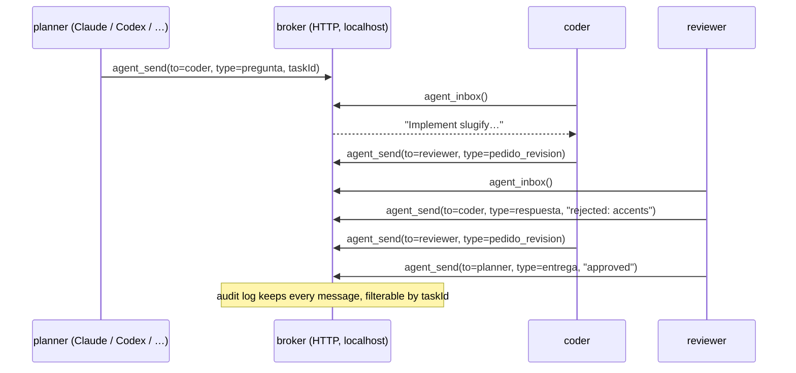

# agent-mesh

**A tiny message bus and MCP server so AI coding agents can ask each other for work and review it.**
Each agent gets three tools — `agent_list`, `agent_send`, `agent_inbox` — and a typed, auditable conversation:
*question → delivery → review request → decision*, optionally tied to a task id. Zero dependencies, ~300 lines of Node.



## Why

Multi-agent setups usually end up as "one agent shells out to another" with no record of who asked what. A broker
gives you the things you actually need when agents delegate to each other: **identity** (who is asking), **typed
intent** (a blocking question is not a status update), **idempotent retries** (`clientRequestId`), **an inbox per
agent**, and **an audit trail** per task you can read afterwards.

## Run the demo (no LLM, no install)

```bash
node demo/three-agents.mjs
```

```
planner  │ → coder: implement slugify(title)
coder    │ → reviewer: attempt 1
reviewer │ → coder: rejected (accents and punctuation are not handled)
coder    │ → reviewer: attempt 2
reviewer │ → planner: approved
audit trail for task-20261111-001: planner→coder(pregunta)  coder→reviewer(pedido_revision)  reviewer→coder(respuesta)  coder→reviewer(pedido_revision)  reviewer→planner(entrega)
```

## Use it with real agents (MCP)

```bash
node src/broker-server.mjs                      # 127.0.0.1:8750 (set MESH_TOKEN to require a bearer token)
```

Add the same MCP server to each agent, changing only its identity (example for Claude Code / any MCP client):

```json
{ "mcpServers": { "mesh": {
  "command": "node", "args": ["/path/to/agent-mesh/src/mcp-server.mjs"],
  "env": { "AGENT_ID": "coder", "AGENT_ROLE": "implements tickets", "MESH_URL": "http://127.0.0.1:8750" } } } }
```

| Tool | What it does |
|---|---|
| `agent_list` | agents on the mesh and how many unread messages each has |
| `agent_send` | `to`, `text`, `type` (`pregunta` `respuesta` `entrega` `pedido_revision` `aviso` `decision`), optional `taskId` (`task-YYYYMMDD-NNN`) and `clientRequestId` |
| `agent_inbox` | read and clear your unread messages |

HTTP API (same broker): `POST /agents`, `GET /agents`, `POST /send`, `GET /inbox?agent=`, `GET /audit?taskId=`, `GET /health`.

## Tests

```bash
npm test      # 6 tests: delivery, idempotency, validation, audit, bearer auth, MCP tools
```

## Design notes and limits

- State is **in memory** (restart = empty inboxes). Persisting the audit log to SQLite/JSONL is the obvious next step.
- Delivery is at-most-once on read; the audit log is the source of truth.
- Auth is a single shared bearer token — fine for one machine/team, not for multi-tenant use.
- Message type names are Spanish (`pregunta`, `entrega`, …) because that is the protocol this was extracted from.

## Origin and licence

The protocol (`agent_send` / `agent_list`, typed messages, `taskId`, `clientRequestId`) comes from a fork of
[T3 Code](https://github.com/pingdotgg/t3code) (MIT, © T3 Tools Inc.) where agents running in separate threads message
each other through an MCP server. That implementation is tied to T3's internals, so this repository is a **clean,
standalone re-implementation** of the idea, not a copy of its code. See [NOTICE](NOTICE). Licensed under [MIT](LICENSE).
